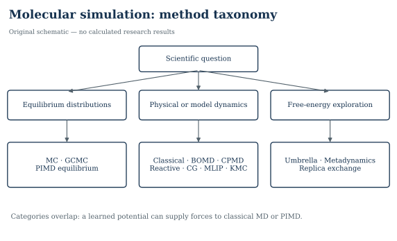

# Molecular Simulation: From Statistical Mechanics to Atomistic Applications

**Maintained by Montassar Bouzidi** · [GitHub profile](https://github.com/montassar-ML)  
An open graduate-level course connecting physical theory, numerical algorithms, computing resources and scientific interpretation.

**Start with [START_HERE.md](START_HERE.md).** The complete source tree is ready for review and subsequent GitHub publication. No live repository publication is claimed by this archive.



## Contents

- [Overview](#overview)
- [Quick start](#quick-start)
- [Course roadmap](#course-roadmap)
- [Theory chapters](#theory-chapters)
- [Method comparison](#method-comparison)
- [Guided applications](#guided-applications)
- [Computational resources](#computational-resources)
- [Evidence and validation](#evidence-and-validation)
- [Contributing, contact and citation](#contributing-contact-and-citation)

<a id="overview"></a>
## Overview

This course is for MSc students, PhD candidates, early-career researchers and experimental scientists learning atomistic simulation. Basic calculus, probability, mechanics and introductory Python are helpful; the roadmap provides a gradual entry.

The aim is to understand **why a method answers a question, what its output means, and which evidence supports the conclusion**. Engine commands accompany the physics. The material covers classical and electronic-structure MD, reactive and coarse-grained models, equilibrium and kinetic MC, enhanced sampling, quantum nuclei and learned potentials.

A central distinction runs through every chapter: **ordinary equilibrium MC does not generate physical molecular trajectories; GCMC adsorption is not diffusion kinetics; KMC is a separate rate-based model.**

<a id="quick-start"></a>
## Quick start

Extract the complete archive and open a terminal in this directory. Python 3.12 was used for the recorded checks.

```bash
python -m venv .venv
```

Activate with `source .venv/bin/activate` on Linux/macOS or `.venv\Scripts\Activate.ps1` in Windows PowerShell. Then:

```bash
python -m pip install -r requirements.txt
python -m unittest discover -s tests -v
python -m scripts.run_lj --equil 1000 --steps 4000 --out outputs/lj
python -m scripts.analyze_lj outputs/lj/trajectory.npz
```

Open `outputs/lj/diagnostics.svg`. This is a teaching run, not a converged material-property measurement. For notebooks install `requirements-dev.txt` and open the [notebooks folder](notebooks/README.md). OpenMM, ASE, LAMMPS, CP2K and RASPA3 are optional; the core course runs without them.

<a id="course-roadmap"></a>
## Course roadmap

| Level | Learn | Practice | Evidence of learning |
|---|---|---|---|
| Beginner | States, probability, Newtonian forces, units | Boltzmann populations and LJ integration | Explain what an ensemble average represents |
| Intermediate | Force fields, ensembles, structure and transport | LJ liquid/solid; water/electrolyte | Defend an estimator and its convergence checks |
| Advanced | GCMC, AIMD, enhanced sampling and quantum nuclei | MFI preparation, CP2K input, umbrella WHAM | Match statistical measure, algorithm and observable |
| Research | Model validation, uncertainty, HPC and MLIPs | Application protocol and model audit | Separate numerical, sampling and model evidence |

[Detailed learning sequence and assessments](LEARNING_ROADMAP.md) · [Conventions](docs/CONVENTIONS.md)

<a id="theory-chapters"></a>
## Theory chapters

| Foundations | Methods | Analysis and research |
|---|---|---|
| [1. Statistical mechanics](docs/01_statistical_mechanics.md) | [8. Monte Carlo](docs/08_monte_carlo.md) | [17. Trajectory analysis](docs/17_trajectory_analysis.md) |
| [2. Classical MD](docs/02_classical_md.md) | [9. GCMC](docs/09_gcmc.md) | [18. Uncertainty and convergence](docs/18_uncertainty_convergence.md) |
| [3. Force fields](docs/03_force_fields.md) | [10. Kinetic MC](docs/10_kinetic_monte_carlo.md) | [19. Computational performance](docs/19_computational_performance.md) |
| [4. Integrators](docs/04_integrators.md) | [11. Born–Oppenheimer AIMD](docs/11_ab_initio_md.md) | [20. Software comparison](docs/20_software_comparison.md) |
| [5. Ensembles](docs/05_ensembles.md) | [11B. Car–Parrinello MD](docs/11b_car_parrinello_md.md) | [21. Research applications](docs/21_research_applications.md) |
| [6. Thermostats/barostats](docs/06_thermostats_barostats.md) | [12. Reactive MD](docs/12_reactive_md.md) | [22. Validation and mistakes](docs/22_validation_common_mistakes.md) |
| [7. Equilibration](docs/07_equilibration.md) | [13. Coarse-grained MD](docs/13_coarse_grained_md.md) | [Equation review](EQUATION_REVIEW.md) |
| [Units and conventions](docs/CONVENTIONS.md) | [14. Enhanced sampling](docs/14_enhanced_sampling.md) | [Resource worksheet](COMPUTATIONAL_RESOURCES.md) |
| [Source-review rationale](SOURCE_REVIEW.md) | [15. Path-integral MD](docs/15_path_integral_md.md) | [Scientific checklist](CHECKLIST.md) |
| [Reference bibliography](references.md) | [16. ML potentials](docs/16_ml_potentials.md) | [Validation report](VALIDATION_REPORT.md) |

<a id="method-comparison"></a>
## Method comparison

| Family | Main object | Does it provide physical time? | Principal uncertainty |
|---|---|---|---|
| Classical MD | Newtonian trajectory under a fitted potential | Model-dependent classical dynamics; coupling can alter it | Potential, finite size and sampling |
| BOMD | Classical nuclei on an electronic ground-state surface | Adiabatic classical-nuclear dynamics | Electronic approximation and short trajectories |
| CPMD | Coupled nuclei and fictitious orbital dynamics | Nuclear dynamics requires adiabatic-separation checks | Fictitious inertia and electronic–nuclear coupling |
| Reactive MD | Geometry-dependent bonding potential | Model-dependent reactive dynamics | Chemical parameterization and barriers |
| Coarse-grained MD | Reduced coordinates and effective interactions | Mapping/friction need justification | Lost degrees of freedom and transferability |
| Equilibrium MC | Markov chain sampling a target measure | **No** | Mixing, proposal correctness and model |
| GCMC | Variable-number equilibrium configurations | **No** | Fugacity, host/guest model and insertion sampling |
| KMC | Continuous-time event process | Yes, conditional on the rate model | Rates, event catalogue and Markov approximation |
| Enhanced sampling | Biased/replica-assisted exploration | Usually not unbiased event kinetics | Hidden barriers, overlap and reweighting |
| PIMD | Imaginary-time quantum equilibrium paths | **Not exact real-time quantum dynamics** | Bead/estimator convergence and potential |
| MLIP-MD | MD with learned forces | Depends on base dynamics and validated domain | Reference bias, extrapolation and data coverage |

[Full method–application–resource matrix](METHOD_APPLICATION_RESOURCE_MATRIX.md)

<a id="guided-applications"></a>
## Guided applications

| Case | System and objective | Supplied execution scope |
|---|---|---|
| [A. LJ liquid](tutorials/01_lennard_jones/README.md) | Energy, temperature, RDF, MSD and VACF | Python executed; LAMMPS variant unexecuted |
| [B. Solid-state MD](tutorials/02_solid_state_md/README.md) | FCC vibrations; optional copper/EMT | LJ and ASE short runs executed |
| [C. Water/electrolyte](tutorials/03_water_electrolyte/README.md) | Hydrogen bonds, ion coordination, molecular MSD | Short OpenMM CPU run and analysis executed |
| [D. Porous adsorption](tutorials/04_gcmc_adsorption/README.md) | Ideal-gas GCMC check and public methane/MFI input | Ideal gas executed; RASPA3 input unexecuted |
| [E. AIMD water](tutorials/05_aimd_water/README.md) | Electronic force and convergence workflow | Geometry prepared; CP2K inputs unexecuted |
| [F. Free energy](tutorials/06_free_energy/README.md) | Umbrella sampling and WHAM | Toy MC and estimator executed |
| [G. Optional MLIP audit](tutorials/07_mlip_md/README.md) | Reference-domain and deployment assessment | Guided design exercise; no weights bundled |

All short runs are diagnostics. No converged experimental comparison, uptake capacity, diffusion coefficient or hardware speedup is asserted.

<a id="computational-resources"></a>
## Computational resources

Use [COMPUTATIONAL_RESOURCES.md](COMPUTATIONAL_RESOURCES.md) for hardware tiers, method/system comparisons, step/storage formulas and a fill-in pilot worksheet. [Chapter 19](docs/19_computational_performance.md) explains MPI, OpenMP, GPUs, scaling and checkpoints. Numerical hardware examples are explicitly illustrative unless measured in the validation record.

<a id="evidence-and-validation"></a>
## Evidence and validation

- [Verified references](references.md) and [BibTeX](references.bib), connected to chapter claims.
- [Literature/application map](docs/21_research_applications.md) and [source review](SOURCE_REVIEW.md).
- [Original editable figures](figures/README.md), regenerated from [Python source](scripts/make_figures.py).
- [Scientific and execution validation report](VALIDATION_REPORT.md), including limitations.
- [Tests](tests/test_numerics.py) and [automated documentation checker](scripts/check_repository.py).
- [Third-party attribution](ATTRIBUTION.md) and [data provenance](data/THIRD_PARTY_PROVENANCE.json).

Mathematical displays use GitHub-compatible fenced math blocks. Notebook cells also contain analytical and synthetic teaching data, clearly separated from simulation output.

<a id="contributing-contact-and-citation"></a>
## Contributing, contact and citation

[Contributing](CONTRIBUTING.md) · [Contact](CONTACT.md) · [Citation metadata](CITATION.cff) · [Publication guide](GITHUB_RELEASE.md)

Original prose and figures: CC BY 4.0. Original code: MIT. Third-party files retain their licenses. See [LICENSE](LICENSE). Contributions should improve physical correctness, pedagogy or reproducibility and preserve the distinction between completed checks and unexecuted work.
