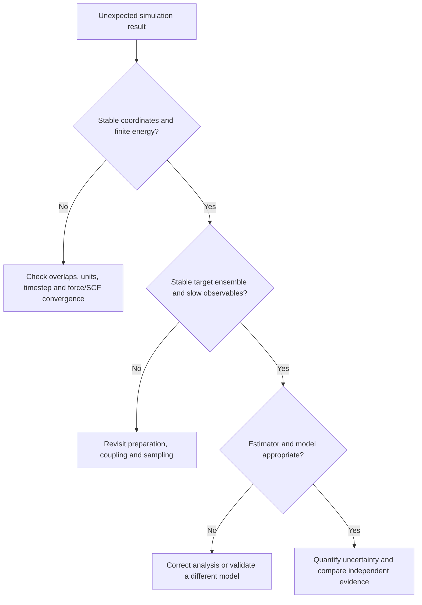
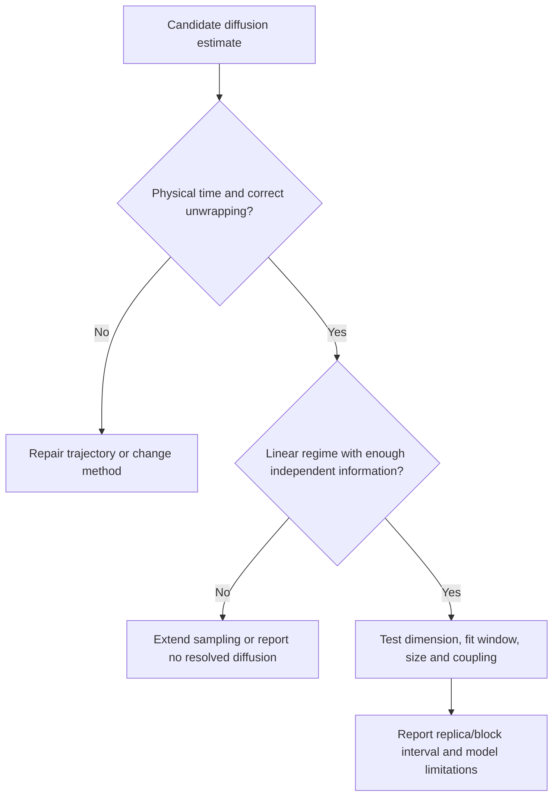

# 22. Validation and common mistakes

[Checklist](../CHECKLIST.md) · [Uncertainty](18_uncertainty_convergence.md)

## A decision tree for unrealistic behavior

The branches are diagnostic priorities, not a guarantee that only one error exists.

| Symptom or mistake | Diagnostic | Corrective action and remaining limitation |
|---|---|---|
| NVE energy drift | Halve timestep; finite-difference forces; inspect discontinuities and solver tolerances | Fix source; bounded energy still does not validate the potential |
| Temperature explosion | Inspect overlaps, masses, unit conversion and constraints | Repair preparation/model; do not hide it with stronger thermostat |
| Wrong density | Confirm pressure units, barostat and phase; run from distinct volumes | Check parameters and equilibrium; one target density is insufficient |
| Too-short production | Block means, slow transitions, independent starts | Extend or change sampling; more frames alone do not help |
| Incorrect thermostat | Inspect kinetic distribution and coupling sensitivity | Use appropriate ensemble method; transport remains sensitive |
| Missing electrostatics | Check charges, exclusions, PME/PPPM/Ewald settings | Restore consistent long-range model and converge it |
| Periodic artifacts | Compare cell sizes/shapes, slab treatment, cutoff geometry | Increase/modify cell; separate finite-size and model effects |
| Wrapped MSD | Inspect image flags and boundary crossings | Recompute with valid unwrapped coordinates |
| Incorrect RDF | Check shell volumes, self exclusion, pair counting, finite-$N$ convention | Test ideal gas; confined geometry needs different normalization |
| MC acceptance treated as convergence | Compare independent estimates and effective samples per cost | Tune preparation proposals; inspect barriers |
| MC movie treated as transport | Change proposal width and see arbitrary sweep displacement | Use MD or a justified rate-based KMC model |
| False confidence intervals | Compare blocking/replicas; assess stationarity | Use suitable correlated-data estimators and disclose limitations |
| AIMD heating | Tighten SCF, timestep, grid and basis independently | Inspect failed frames; DFT model error remains |
| Reactive false events | Vary bond threshold/persistence, inspect products and energetics | Validate chemistry and event definition |
| MLIP instability | Check domain, neighbor cutoff, energy–force consistency, challenge data | Add justified reference data; do not trust committee agreement alone |
| Nonrepresentative snapshots | Sample times/replicas and slow basins deliberately | State selection rule and representativeness limits |
| Free-energy false convergence | Window overlap, forward/backward initialization, hidden coordinates | Resample missing information; optimizer convergence is only numerical |

## A diffusion-specific decision tree

## Research-grade reporting

A reproducible report identifies the scientific question, Hamiltonian/parameters, initial structure, boundary conditions, ensemble, integration/coupling, electronic settings where applicable, preparation, production, seeds, output, analysis conventions, uncertainty and convergence. Include actual input and analysis versions, not only a software name.

Distinguish a successful program exit, a mathematically correct estimator, a converged simulation, a validated model and experimental agreement. The repository's [validation report](../VALIDATION_REPORT.md) applies the same distinction to these teaching examples.

**Exercise:** take one claim from a paper or your own planned study and write five sentences, one for each evidence category. Identify which category has the weakest evidence.

**Sources:** [Grossfield](../references.md#grossfield2018), [Allen–Tildesley](../references.md#allen2017), [MLIP review](../references.md#deringer2019).
